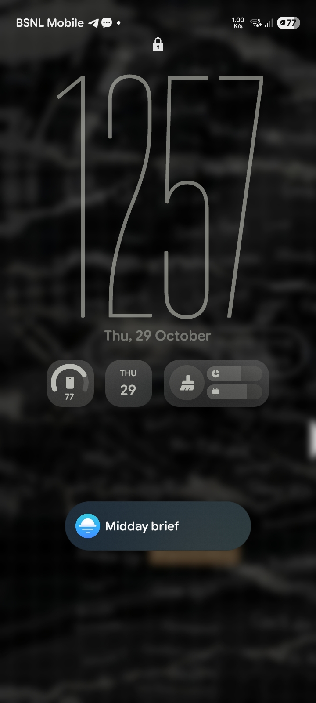
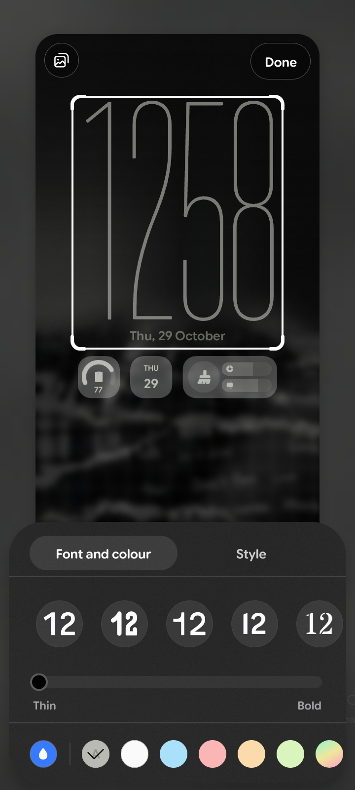
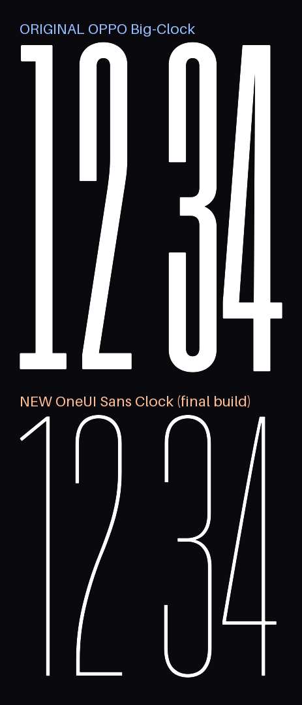

# OneUiSansBigClock

A lockscreen clock font for ColorOS / OPPO devices, set in the One UI Sans clock
typeface. It replaces the stock "big clock, no colon" style.

Requires Android 14 or newer.

## Preview







## Installation

1. Install `OneUiSansBigClock.apk`. If an earlier version of the same font pack
   is already installed, uninstall it first.
2. Open the lockscreen clock settings and choose **OneUiSansBigClock** from the
   font list.

## Credits

- **Base package** — the original ColorOS "big clock, no colon" font module, by
  HeheJuice ([@HeheJuice](https://t.me/HeheJuice) on Telegram).
- **TTF fixing** — [@Alizabp](https://t.me/Alizabp) on Telegram.

## Contents

```
OneUiSansBigClock.apk   the clock font package
preview.png             outline comparison
screenshots/            lockscreen and font list previews
source-apk/             the original package this was built from
build/                  build scripts
fonts/                  source font
```
